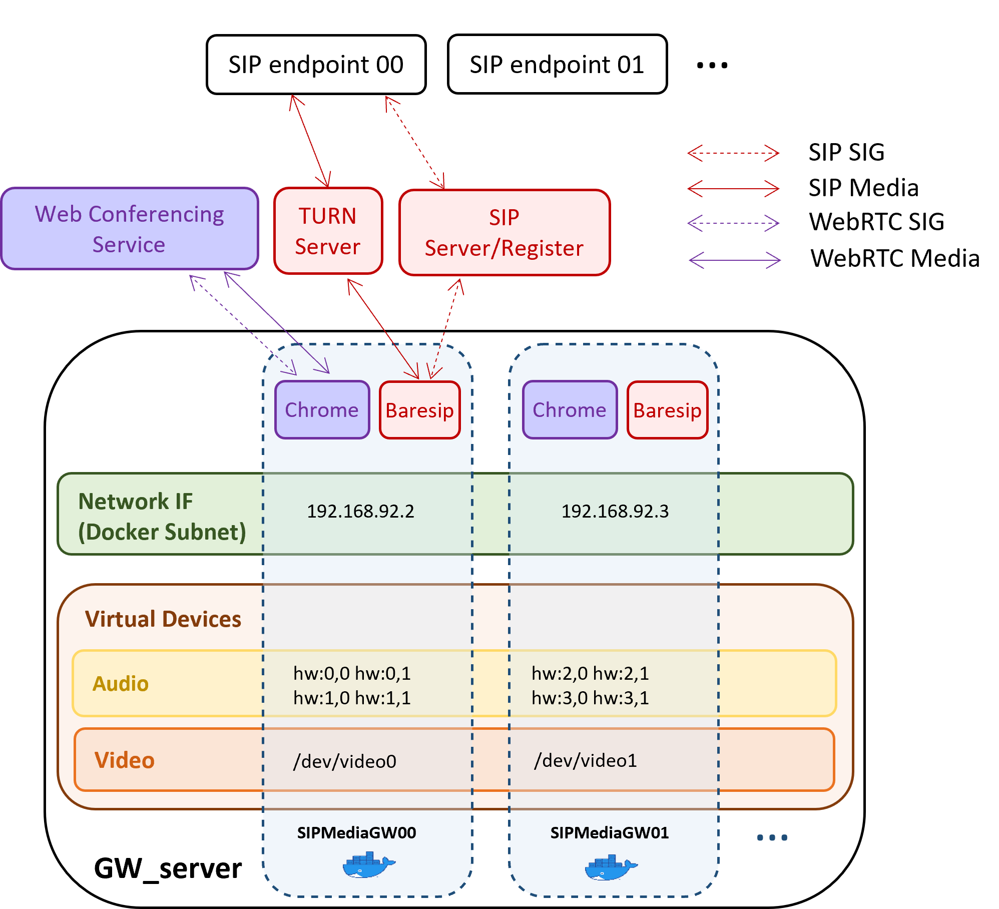

SIPMediaGW in-depth
--------

Environment
--------

### <a name="devices">Virtual devices </a>
Example for 4 gateways, co-hosted on GW_server machine:

- **Audio**

		sudo apt-get install -y linux-modules-extra-$(uname -r)
		echo "options snd-aloop enable=1,1,1,1,1,1,1,1 index=0,1,2,3,4,5,6,7" | sudo tee  /etc/modprobe.d/alsa-loopback.conf
		echo "snd-aloop" | sudo tee -a /etc/modules
		sudo modprobe snd-aloop

- **Video**

		sudo apt-get install -y v4l2loopback-dkms
		echo "options v4l2loopback devices=4 exclusive_caps=1,1,1,1" | sudo tee  /etc/modprobe.d/v4l2loopback.conf
		echo "v4l2loopback" | sudo tee -a /etc/modules
		sudo modprobe v4l2loopback

### Docker network ### 

A user-defined bridge network to connect the gateways:

	docker network create  --subnet=192.168.92.0/29 gw_net

### SIP register and TURN server ###

To be accessible from any SIP endpoint, the gateway needs SIP registering facilities.
Kamailio is an open-source SIP server which can be easily installed.

To overcome NAT traversal issues, a TURN server acts as a media traffic relay. Coturn is an open-source STUN and TURN implementation.

Before starting the gateway, a local (docker based) testing environment (Kamailio and Coturn) may be simply started as follows:

	docker compose -f deploy/docker-compose.yml up -d --force-recreate sip_server turn_server
 
### SIP capture and Homer

For troubleshooting/monitoring purposes, real-time packet capture and visualization tools can be deployed as follows:

	docker compose -f deploy/docker-compose.yml up -d --force-recreate heplify_server homer_webapp

### WebRTC statistics (rtcstats)

The browser side of a call can stream its WebRTC API calls and `getStats()` results to an [rtcstats](https://github.com/rtcstats/rtcstats) server:

	RTCSTATS_ENABLED=true
	RTCSTATS_SERVER_URL=wss://rtcstats.example.org/sipmediagw   # append ?rtcstats-token=<jwt> if the server requires one

The library is loaded in the call's Chrome as an extension content script (generated in `/tmp/sipmediagw-rtcstats` when the call starts), so it wraps WebRTC before the meeting scripts run, in every tab and frame, including the tab some platforms open to run the meeting. The URL must start with `ws://` or `wss://`, otherwise tracing stays off. Each frame that uses WebRTC opens its own connection (one dump per frame); frames without WebRTC open none. The trace is closed when the call ends, after the gateway leaves the meeting.

The gateway adds `gw` (GW_NAME), `room` and `browsing` (the platform) to the URL query; the server records them in the dump's `url` metadata. The query, and so the token, is never written to the gateway logs. Look for these lines:

	rtcstats: tracing to <url without query>
	rtcstats: trace closed

A failure (server down, library missing) turns tracing off with a `rtcstats:` log line and never stops the call.

Usage
--------

SIPMediaGW.sh is a helper script to automate gateway launching, is able to launch as many gateways (running in the same time) as possible, in accordance with [CPU_PER_GW](https://github.com/Renater/SIPMediaGW/blob/main/.env#L6) environment variable value.
 > **Note**\
 > When running multiple gateways simultaneously, this script automatically check ressources availlability (assuming that all the CPU is dedicated to SIPMediaGW instances) but does not perform any virtual video devices provisionning.

Launch a gateway:

	SIPMediaGW.sh

The gateway will automatically stop after the call is closed.

Troubleshoot
--------

Logs:

	tail -f /var/log/syslog | grep mediagw
	
Inspect Kamailio database:

	docker run -it --network=host --entrypoint mysql mysql -h 127.0.0.1 -u root -pdbrootpw kamailio -e "SELECT username, locked, to_stop FROM location"
